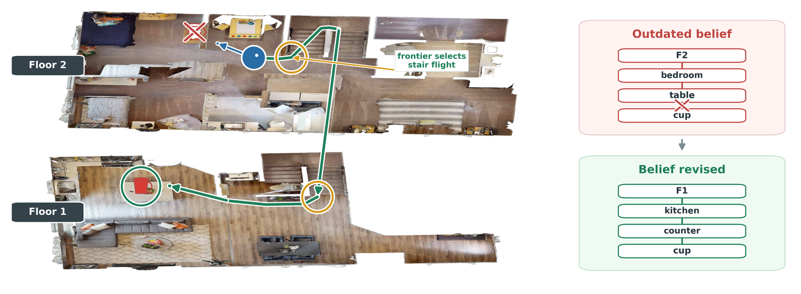
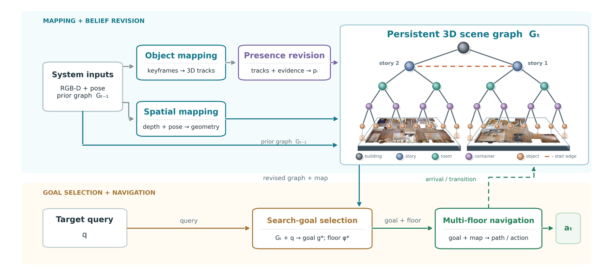
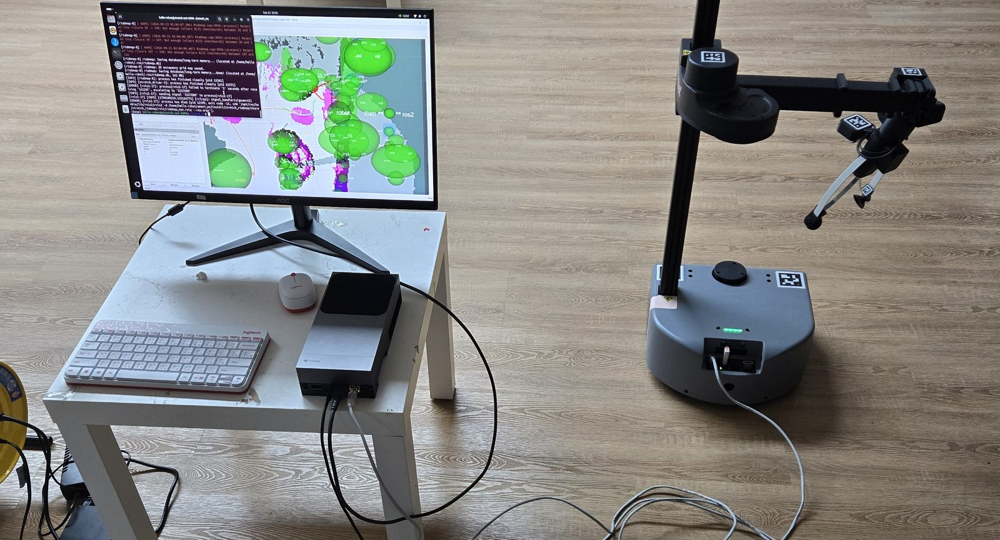

> **stretch_main vendored copy.** This repo's `docker/` was removed here: OSG runs inside
> stretch_main's sim container (conda envs from `scripts/scene_graph_demo/install_osg_envs.sh`).
> Setup: [scripts/scene_graph_demo/README.md](../../../scripts/scene_graph_demo/README.md).
> Local changes: [VENDORED.md](VENDORED.md).

<div align="center">

# MD-SG: Multi-floor Open-vocabulary Online 3D Scene Graph with Dynamic Handling Navigation

**ICRA 2027 (submitted)**

[📄 Paper](docs/PAPER.md) · [🏗️ Architecture](docs/ARCHITECTURE.md) · [🤖 Real robot](docs/ROS2.md) · [📚 All docs](docs/README.md)



*A cup seen in an upstairs bedroom is moved to the downstairs kitchen. MD-SG revisits the remembered location, finds it empty, revises its belief, selects the stair flight, and recovers the cup on the other floor — the revised scene graph on the right.*

</div>

## Abstract

Object-goal navigation in changing indoor environments requires robots to recover targets relocated within or across floors. Previously observed object locations can become outdated, requiring agents to revise their scene memory during search. We introduce **MD-SG**, an online, open-vocabulary 3D scene graph navigation pipeline built around two complementary mechanisms: **(1) Presence-Belief Revision**, which uses visibility-gated visual-geometric evidence to reassess remembered object locations, and **(2) Belief-Guided Search and Unified Selection**, which combines scene-graph priors with inspection evidence to balance candidate inspection and frontier exploration. Integrated within a floor-aware scene graph, these mechanisms allow the agent to reject outdated locations and redirect search within or across floors. On single-floor cross-anchor relocation tasks in HM3D, MD-SG achieves a success rate of 52.8 %, compared with 30.2 % for DualMap re-evaluated under the same protocol. We further introduce a cross-floor relocation benchmark comprising 25 episodes across five scenes, on which MD-SG achieves a success rate of 40.0 %. A real-world demonstration additionally illustrates recovery after object relocation.

## Overview

<div align="center"></div>

One persistent, floor-aware scene graph (`building → floor → room → container → object`) and three mechanisms on top of it:

1. **Scene graph** — open-vocabulary detections are back-projected into ellipsoid tracks and filed under their floor, room and container; a stair edge joins two storeys only after a completed traversal.
2. **Presence-belief revision** — each object holds a bounded log-odds belief; a *visible* miss lowers it, an occluded view changes nothing, and a low ceiling lets a few honest misses overturn a long history.
3. **Belief-guided search and the floor decision** — every mapped surface carries a search posterior that failed inspections multiply down; the floor score is the mean over a floor's surfaces, and the agent leaves a storey when what it has searched is spent.

The paper calls the system MD-SG; the code calls it **OSG** (the package is `src/osg/`). `docs/PAPER.md` Appendix A maps every equation to the module that implements it.

## News

- **2026-09** — ICRA 2027 submission; the real-robot demonstration (Stretch 3 + Jetson AGX Thor, two floors, a lift) is recorded.
- **2026-09-27** — cross-anchor reproduced on the original prior maps: 25/53 (see [Results](#results)).

## Installation

Everything runs inside the `nav` container: one image with two conda environments, `habitat` (habitat-sim, OSG, YOLOE) and `ascent` (BLIP-2, MobileSAM, GroundingDINO, RAM++, D-FINE — served over HTTP because the two cannot share an interpreter).

```bash
git clone --recursive <this repo>            # the ASCENT reference is a submodule the image COPYs
cp docker/.env.example docker/.env           # dataset paths, NVIDIA_API_KEY
printf 'UID=%s\nGID=%s\n' "$(id -u)" "$(id -g)" >> docker/.env
docker compose -f docker/compose.yaml --env-file docker/.env build nav
docker compose -f docker/compose.yaml --env-file docker/.env up -d
docker exec -it docker-nav-1 bash            # habitat env active; PYTHONPATH set
```

Inside the container, download the data and weights once (HM3D needs a free licence):

```bash
python scripts/download_data.py --username <TOKEN_ID> --password <TOKEN_SECRET> --uids hm3d_val_v0.2
python scripts/download_data.py --episodes-only
python scripts/download_weights.py && python scripts/download_weights.py --pointnav
bash scripts/fetch_ascent_weights.sh
```

For CPU-only development, `pip install -e '.[dev]'` and `pytest tests/unit -q` (1535 tests, ~50 s, no GPU or data). **[docs/SETUP.md](docs/SETUP.md)** covers the submodule, every weight file, the datasets and the two environments in full; **[docs/USAGE.md](docs/USAGE.md)** is the how-to.

## Quick start

```bash
bash scripts/serve_perception.sh                 # the five model servers (tmux `osg_models`); --stop to tear down
python scripts/smoke_habitat.py && python scripts/smoke_ollama.py
python scripts/run_eval.py eval.num_episodes=3   # a smoke run of the default arm
python scripts/run_eval.py +experiment=dualmap_osg_unified 'dualmap.scenes=[00829-QaLdnwvtxbs]' \
    'dualmap.conditions=[cross_anchor]' ycb.map_in=<prior-map-root>/00829-QaLdnwvtxbs
```

A run refuses to start if a model server or ollama it needs is down (`PerceptionUnavailable`) — deliberately; a silent zero from a dead server looks like a bad algorithm. Outputs land in `outputs/<run>/`: `summary.json` (SR/SPL, per-module FPS, config fingerprint), `episodes.jsonl` (per-episode diagnostics), `viz/`, and with `eval.debug_frames=true` a per-step `viz/debug/*.mp4`.

Two things to know before comparing numbers: **`navmesh` and `nav2` are privileged movers** (they are given simulator geometry) and their SR/SPL must never be set beside the sensor-only `costmap` / `pointnav`; and **runs are not reproducible while the VLM verifier is on** — use `verification=off` for any A/B meant to prove two configs equivalent.

## Benchmarks

The premise is a map that is **actively wrong**, not merely incomplete: pass 1 explores the static layout and snapshots the scene graph, the objects are moved, and pass 2 starts from that snapshot believing the target is where it no longer is ([docs/DYNAMIC_EXPERIMENT_PROTOCOL.md](docs/DYNAMIC_EXPERIMENT_PROTOCOL.md)).

| benchmark | scenes | trials | preset | source |
|---|---|---|---|---|
| DualMap's released single-floor benchmark — static / in-anchor / cross-anchor | 00829, 00848, 00880 | 79 / 54 / 53 | `dualmap_osg_unified` | DualMap's `HM3D_collect` release, imported by `scripts/import_collector_layouts.py` |
| **Multi-floor cross-anchor** (ours) — the target is moved to another storey | 00800, 00821, 00862, 00873, 00878 | 25 | `mf5_osg_on_ascent_map` vs `mf5_ascent_crossanchor` | authored YCB layouts, the data collector's `outputs/dualmap_multifloor` |
| Authored fifteen-scene benchmark (ours) | 15 HM3D v0.2 scenes | 111 objects | `ycb15_osg_unified` | the data collector's `outputs/dualmap_authoring` |

Pass-1 maps are built once with `scripts/campaign/rebuild_maps.sh` / `scripts/run_prior_maps.sh`; the DualMap arm runs through `scripts/run_dualmap_arm.sh` and the multi-floor arm through `scripts/run_mf5_pass2.sh`.

## Results

**Table I — DualMap's released benchmark (HM3D, success rate %)**

| condition | ConceptGraphs | HOV-SG | DualMap | DualMap (re-eval.) | **MD-SG** |
|---|---|---|---|---|---|
| static | 61.5 | 52.6 | 70.5 | 67.1 | 64.6 |
| dynamic, in-anchor | – | – | 64.8 | 64.8 | 63.0 |
| dynamic, cross-anchor | – | – | 60.3 | **30.2** | **52.8** |

**Table II — multi-floor cross-anchor (25 episodes, 5 scenes)**

| method | SR (%) | SPL |
|---|---|---|
| ASCENT | 0.0 | 0.000 |
| **MD-SG** | **40.0** | **0.162** |

**Table III — ablation on the 53 cross-anchor trials**: w/o presence-belief revision 41.5 %, w/o belief-guided surface scoring 35.8 %, full system 52.8 %.

**What reproduces on the current tree.** Table II re-derives (11/25 = 44.0 %, SPL 0.196). Table I's cross-anchor row depends on the pass-1 prior map and on the container image: with the original maps the current image gives **25/53 = 47.2 %** (in-anchor 35/54 = 64.8 %), against 28/53 in the image the paper's run used; the 25–28 gap is a float-level perturbation of perception that flips one late decision in three episodes. Read **[docs/CROSS_ANCHOR_REPRODUCTION.md](docs/CROSS_ANCHOR_REPRODUCTION.md)** before quoting Table I; Appendix B of the paper traces every number to its run.

## Real robot

<div align="center"></div>

A Hello Robot Stretch 3 keeps its own Nav2 navigation and localisation; a Jetson AGX Thor beside it runs perception, the scene graph and the belief revision and publishes goal poses — *the pipeline keeps doing all of the thinking and stops steering.* Nav2's map is 2-D, so the storey is declared by the operator (`/osg/floor`), and a wheeled robot takes the lift. [docs/ROS2.md](docs/ROS2.md) is the layer, [docs/THOR.md](docs/THOR.md) the deployment:

```bash
python scripts/run_robot.py +experiment=stretch3_map    ros2.map_tag=lab ros2.target='sports ball'   # pass 1
# move the ball upstairs
python scripts/run_robot.py +experiment=stretch3_search ros2.map_tag=lab ros2.target='sports ball'   # pass 2
bash scripts/ros2/switch_floor.sh 1 lab_upstairs                                                     # after the lift
```

Check the whole path with no robot present: `bash scripts/ros2/check_pipeline.sh`.

## Repository layout

| | |
|---|---|
| `src/osg/` | the pipeline: `perception` → `objects` → `mapping` → `graph` → `exploration` → `planning` → `verification` → `agent` → `sim` / `eval` / `ros2` |
| `src/navigation/` | a line-by-line transcription of ASCENT's control flow, run in the same harness as the reference policy |
| `configs/` | Hydra groups backed by typed dataclasses; `configs/experiment/` the presets the paper's arms are made of, `archive/` the exploratory ladders |
| `scripts/` | entry points, model servers, downloads, `analyze_*` diagnostics, `render_*` figure renderers, `ros2/`, `video/`; `legacy/` the one-off probes behind `docs/history/` |
| `tests/` | `unit/` (synthetic, CPU) with two golden files that pin every calibrated constant and every preset's composition; `integration/` (`-m sim`) |
| `docs/` | reference documentation; `docs/history/` the experiment logs and frozen results the numbers trace back to |
| `docker/` | the x86 image (both conda envs) and the Jetson Thor + ROS bridge pair |

## Citation

```bibtex
@inproceedings{mdsg2027,
  title     = {{MD-SG}: Multi-floor Open-vocabulary Online 3D Scene Graph with Dynamic Handling Navigation},
  booktitle = {IEEE International Conference on Robotics and Automation (ICRA)},
  year      = {2027},
  note      = {submitted}
}
```

## Acknowledgements

The reference navigation policy and the served perception models come from [ASCENT](https://github.com/Zeying-Gong/ascent) (vendored as a pinned submodule); the single-floor dynamic benchmark is [DualMap](https://github.com/Eku127/DualMap)'s release; scenes are [HM3D](https://aihabitat.org/datasets/hm3d/) under its research licence, rendered with [Habitat](https://aihabitat.org). Object detection is [YOLOE](https://github.com/THU-MIG/yoloe); the object layer follows VOOM's dual-quadric formulation.
